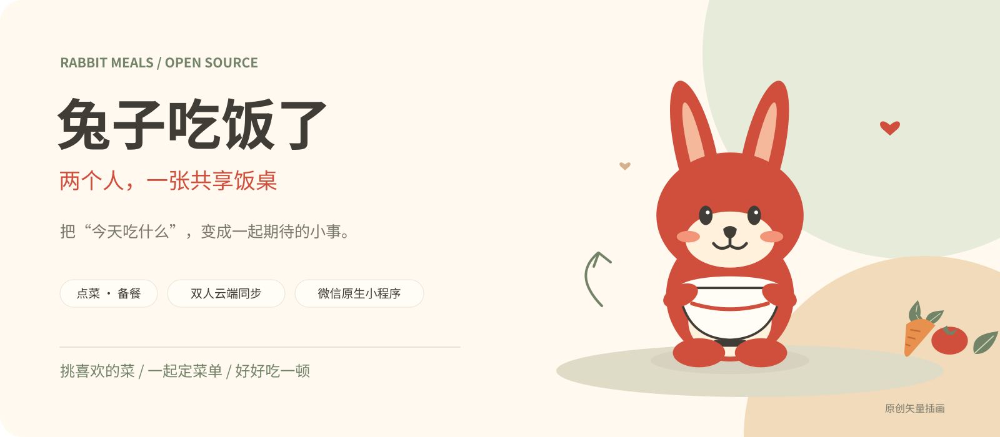
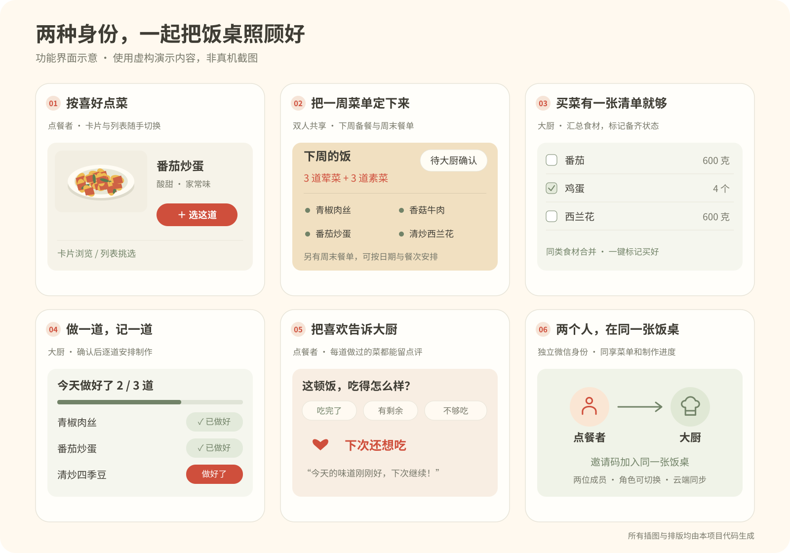
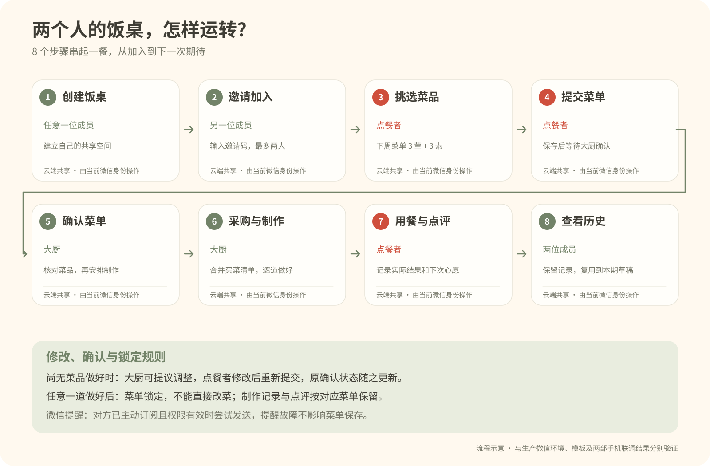

<div align="center">



**一人点菜，一人掌勺。把「下周吃什么」变成两个人的小期待。**

[](https://github.com/davidai1024/rabbit-meals/actions/workflows/test.yml)
[](LICENSE)


[看看功能](#看看功能) · [快速开始](#快速开始) · [双人部署](docs/DEPLOYMENT.md) · [参与改进](CONTRIBUTING.md)

</div>

## 从一句「你想吃什么」开始

这是一个给两个人用的微信原生小程序。点餐的人提前挑好下周想吃的菜，做饭的人接单、买菜、备餐；吃完再留一句点评，顺手点亮「下次还想吃」。

菜单、采购进度和点评都放在同一张共享饭桌里。少来回翻聊天记录，多一点等饭吃的快乐。

## 看看功能



<sub>图中为功能界面示意，非真机截图。公开版内置原创 SVG 插画与 8 道演示菜品，可在自己的菜品库换成自家照片和配方。</sub>

| 点餐者的快乐 | 大厨的小帮手 |
| :--- | :--- |
| **卡片 / 列表选菜**：想慢慢挑，或一眼看全，都可以。 | **一眼看待办**：接单、制作进度和菜谱集中查看。 |
| **下周饭 + 周末餐**：平日备餐和周末现做分开安排。 | **合并买菜清单**：相同食材合并，可标记「家里有」「买好了」。 |
| **重新挑一篮**：提交后继续点，再次提交先确认是否替换。 | **一键买好**：采购齐了，一次标记剩余食材。 |
| **已点与往期记录**：漂亮的菜单卡片，查看每份饭做到哪了。 | **菜品库**：维护分类、口味、食材用量与照片。 |
| **用餐点评**：写点感受，再收藏一个「下次还想吃」。 | **微信提醒（可选）**：订阅后接收菜单提交、首次点评提醒。 |

点餐者的导航是 **点菜 · 已点 · 统计**；大厨的导航是 **做饭 · 买菜 · 统计 · 菜品库**。两位成员都可以切换身份。

## 一份菜单，怎样变成一桌饭



几个小约定，让两个人操作时不打架：

- **本周点下周的饭**，周末菜单另行安排。下周饭按 **3 荤 + 3 素** 选择，每道按 **3 顿**折算。
- **购物篮是草稿，已点菜单才是订单。** 挑新菜不会改动大厨手里的原菜单或买菜清单。
- 再点一篮后提交，会弹出 **「替换菜单 / 取消」**。确认才整份替换；取消保留这一篮，也保留原菜单。
- 从「已点」点修改，会带入原来的菜，改完需要重新提交。实际换菜后大厨重新接单；完全相同的菜单不会重置原确认或重复提醒。
- **任意一道菜标记「做好了」，整份菜单锁定**，点餐者仍可查看和点评。
- 选菜与「做好了」先即时反馈，后台保存；失败保留待同步操作。首次连接有兔子过渡画面和重试入口，已加载页面切换时不反复全屏加载。

## 快速开始

### 1. 下载并检查

```bash
git clone https://github.com/davidai1024/rabbit-meals.git
cd rabbit-meals
npm test
npm run check
```

本地检查建议使用 **Node.js 20 或更新的 LTS 版本**。根目录没有额外 npm 依赖；云函数依赖由微信开发者工具单独安装。

### 2. 先在本机试一试

用微信开发者工具导入**仓库根目录**，即包含 `project.config.json` 的这一层。公开配置中的 AppID 为占位值；按工具提示选择测试账号，或填入自己的小程序 AppID。

`miniprogram/utils/config.js` 默认 `env: ''`，使用本机演示数据。选择身份后，就能体验点菜、接单、买菜和点评；本机模式的数据只存在当前设备。

也可使用 [浏览器辅助预览](docs/DEPLOYMENT.md#浏览器辅助预览)，快速了解交互。两部手机共享数据需要下一步的云开发配置。

### 3. 接上你们自己的共享饭桌

1. 使用自己的 AppID 和微信云开发环境，填写 `config.js.env`。
2. 创建 `mealFamilies`、`mealIdentities`、`mealNotifications` 三个集合，设为**客户端不可读写**；数据通过云函数校验成员身份后访问。
3. 部署 **`cloudfunctions/planningFamily`**，选择「上传并部署：云端安装依赖」。
4. 一个人创建饭桌，另一人用自己的微信输入邀请码加入；每张饭桌最多两位成员。

详细配置、存储权限、可选通知和两机验收步骤见 **[部署指南](docs/DEPLOYMENT.md)**。

## 项目里有什么

```text
rabbit-meals/
├── miniprogram/
│   ├── pages/              # 点菜、已点、采购、统计、菜库、详情与配对，共 8 页
│   ├── custom-tab-bar/     # 随身份切换的底部导航
│   ├── utils/              # 菜单状态、同步队列、页面与通知入口
│   ├── templates/          # 统一加载与连接失败界面
│   └── assets/             # 原创 SVG 插画与图标
├── cloudfunctions/
│   ├── planningFamily/     # 当前双人共享后端
│   └── family/             # 历史兼容实现，当前不以它作为业务服务
├── tests/                  # 状态流转、权限、并发、提醒与页面回归
├── preview/                # 本机浏览器辅助预览
├── docs/                   # 部署、架构和 README 图示
└── scripts/                # 检查工具与原创插画生成器
```

采用原生 **WXML / WXSS / JavaScript + 微信云开发**。核心规则在客户端和云函数两侧校验，云端通过微信上下文识别用户，不信任客户端传入的身份。[进一步了解架构 →](docs/ARCHITECTURE.md)

## 适合怎样使用

适合两个人的家庭点菜、周末备餐，以及学习微信原生小程序、双人同步和状态流转。示例菜品和份量用于演示，实际食材与食量可以在菜品库调整。

本项目按双人轻量场景设计：一张饭桌的业务状态存于一个云文档，长期记录增长需要自行扩展归档。它没有支付、外卖配送、多商户或自动营养推荐功能。

微信云资源套餐、服务类目、备案、隐私与审核，以部署者账号后台的当前要求为准。正式发布前请完成两部手机的真实验收；自动测试和浏览器预览不代表微信审核或消息实际送达。

## 一起把饭桌变得更好

欢迎通过 [Issues](https://github.com/davidai1024/rabbit-meals/issues) 提出问题，或提交 Pull Request。复现时请附上角色、页面、操作顺序和预期结果；不要附上邀请码、OpenID 或私人饭桌数据。

[贡献指南](CONTRIBUTING.md) · [素材与示例说明](NOTICE.md) · [安全说明](SECURITY.md)

## 许可证

代码和本公开版本中重新绘制的 SVG 插画采用 [MIT License](LICENSE)。公开版不包含原部署账号配置、私人饭桌记录或来源未确认的参考照片。

<div align="center">

**菜单可以改，饭要好好吃。**

</div>
